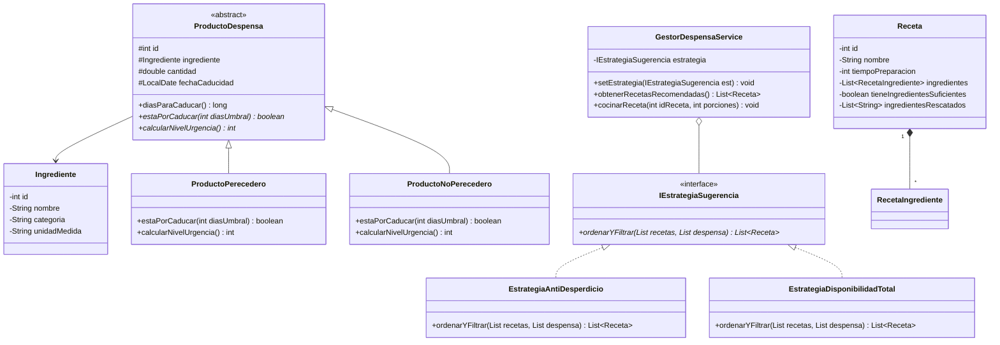

# FIT-EAT: Sistema Inteligente de Gestión de Despensa y Recetario Anti-Desperdicio


-F44336?style=for-the-badge&logo=eclipse&logoColor=white)


**Proyecto Final de Programación Orientada a Objetos II (POO2)**  
*Ingeniería en Computación / Sistemas — 3er Semestre*  
**Autor:** Alan Baruch ([@Alan12O](https://github.com/Alan12O))  
**Presentación en Canva:** [Ver Diapositivas de Exposición](https://www.canva.com/d/o4xWCJuFa8wyRVQ) | [Guion de Defensa 20 min](docs/EXPOSICION_20MIN.md)

---

## 📌 Descripción General

**FIT-EAT** es una aplicación web integral diseñada para erradicar el desperdicio doméstico de alimentos mediante la gestión inteligente de inventario por lotes y un motor de recomendación algorítmica de recetas en tiempo real.

El sistema modela el dominio aplicando los principios fundamentales de la Programación Orientada a Objetos (abstracción, herencia, polimorfismo, encapsulamiento), patrones de diseño GoF (*Strategy*, *DAO*, *Singleton*) y una arquitectura multicapa desacoplada bajo la especificación Jakarta EE / J2EE, comunicada vía APIs RESTful en formato JSON.

---

## ✨ Características Principales

1. **Gestión por Lotes Independientes:**
   - Registro de productos manteniendo trazabilidad individual de cantidad y fecha de vencimiento (`fecha_caducidad`).
   - Diferenciación polimórfica entre `ProductoPerecedero` y `ProductoNoPerecedero`.

2. **Monitoreo Preventivo de Caducidades:**
   - Panel de control de caducidades con separación visual entre insumos **Vencidos** (para desecho o acción inmediata) y **Por Caducar** (en los próximos 3 días).
   - Indicador de alerta roja en tiempo real en los KPIs del Dashboard.

3. **Motor de Sugerencia Inteligente de Recetas (Patrón Strategy):**
   - **♻️ Modo Anti-Desperdicio:** Prioriza recetas que rescatan alimentos en riesgo inminente de caducidad (urgencia $\le 3$ días o vencidos), destacando en cada ficha exactamente qué ingredientes se salvan.
   - **⚡ Modo Disponibilidad Total:** Muestra primero recetas con 100% de ingredientes disponibles en despensa, ordenadas de menor a mayor tiempo de cocción (5 min, 10 min, 12 min...).
   - Intercambio de algoritmos en tiempo de ejecución sin recargar la página.

4. **Algoritmo de Consumo FIFO (First In, First Out):**
   - Al cocinar cualquier receta seleccionando el número de porciones deseadas, el sistema descuenta automáticamente los lotes con la fecha de caducidad más antigua.

5. **Experiencia de Usuario Moderna:**
   - Single Page Application (SPA) construida en HTML5 semántico, CSS3 moderno con variables y Grid/Flexbox, e iconos vectoriales SVG limpios.

---

## 🏛️ Arquitectura del Sistema (Modelo J2EE)

El proyecto implementa una arquitectura multicapa desacoplada:

```
[ Cliente Web / Navegador ]
         │
         │  (HTTP / Fetch Asíncrono - JSON)
         ▼
[ Capa de Control / Servlets ]
   ├── DespensaServlet      (/api/despensa)
   ├── RecetaServlet        (/api/recetas)
   └── IngredienteServlet   (/api/ingredientes)
         │
         ▼
[ Capa de Negocio / Servicios ]
   └── GestorDespensaService
         ├── IEstrategiaSugerencia (Patrón Strategy)
         │     ├── EstrategiaAntiDesperdicio
         │     └── EstrategiaDisponibilidadTotal
         └── Algoritmo de Consumo FIFO
         │
         ▼
[ Capa de Persistencia / DAOs ]
   ├── DespensaDAO
   ├── IngredienteDAO
   ├── RecetaDAO
   └── ConexionBD (Patrón Singleton)
         │
         ▼
[ Base de Datos Relacional ]
   └── MySQL 8.0 (despensa_db)
```

---

## 📐 Diagrama de Clases UML



---

## 🗄️ Base de Datos y Modelo Entidad-Relación

La base de datos relacional opera sobre **MySQL 8.0** con el esquema `despensa_db`:

- `ingredientes`: Catálogo maestro de alimentos, categoría y unidad de medida.
- `despensa`: Lotes almacenados con cantidad física y fecha de vencimiento (`fecha_caducidad`).
- `recetas`: Catálogo de platillos con instrucciones y tiempo de preparación.
- `receta_ingredientes`: Relación muchos a muchos que define los insumos requeridos por porción base.

El script de inicialización se encuentra en [`src/main/resources/schema.sql`](src/main/resources/schema.sql).

---

## 🌐 Endpoints de la API REST

Todas las respuestas son entregadas en `application/json;charset=UTF-8`:

| Método | Endpoint | Descripción |
| :---: | :--- | :--- |
| `GET` | `/api/ingredientes` | Retorna el catálogo completo de ingredientes. |
| `GET` | `/api/despensa` | Lista todos los lotes de despensa con sus días calculados. |
| `POST` | `/api/despensa` | Registra un nuevo lote (`idIngrediente`, `cantidad`, `fechaCaducidad`). |
| `PUT` | `/api/despensa` | Modifica la cantidad disponible de un lote específico. |
| `DELETE` | `/api/despensa?id={id}` | Elimina un lote de la despensa. |
| `GET` | `/api/recetas?estrategia={tipo}` | Sugiere recetas ordenadas por `antidesperdicio` o `disponibilidad`. |
| `POST` | `/api/recetas` | Descuenta insumos bajo lógica FIFO para `idReceta` y `porciones`. |

---

## 🚀 Requisitos e Instalación

### Requisitos Previos:
- **Java Development Kit (JDK):** Versión 17 o superior.
- **Apache Maven:** 3.8+ (o utilizar el wrapper `./mvnw` incluido).
- **Apache Tomcat:** 10.1 o 11.0 (Jakarta EE 10 / Servlet 6.0).
- **MySQL Server:** 8.0+.

### Pasos de Despliegue:

1. **Clonar el repositorio:**
   ```bash
   git clone https://github.com/Alan12O/Proyecto-fit-eat.git
   cd Proyecto-fit-eat
   ```

2. **Configurar la Base de Datos:**
   Importar el script SQL en MySQL:
   ```bash
   mysql -u root -p < src/main/resources/schema.sql
   ```
   *(Asegurarse de que el usuario y contraseña coincidan con `ConexionBD.java` o pasarlos mediante variables de entorno `DB_USER` y `DB_PASSWORD`).*

3. **Compilar y Empaquetar con Maven:**
   ```bash
   # En Windows:
   .\mvnw.cmd clean package

   # En Linux / macOS:
   ./mvnw clean package
   ```
   Esto generará el archivo `target/proyectoFinal-1.0-SNAPSHOT.war`.

4. **Ejecutar en Tomcat / IntelliJ IDEA:**
   - Desplegar el artefacto `proyectoFinal:war exploded` o el `.war` empaquetado en Apache Tomcat 11.
   - Abrir en el navegador: `http://localhost:8080/proyectoFinal_war_exploded/` (o la ruta raíz configurada).

---

## 📚 Material de Exposición

Para la defensa académica del proyecto, se incluye:
- **Guía de Exposición de 20 Minutos:** [`docs/EXPOSICION_20MIN.md`](docs/EXPOSICION_20MIN.md) con minutero cronometrado y notas del orador diapositiva por diapositiva.
- **Presentación en Canva:** [Enlace a Presentación Canva](https://www.canva.com/d/o4xWCJuFa8wyRVQ) con 13 diapositivas siguiendo la identidad visual de la app y espacios designados para capturas en vivo.
