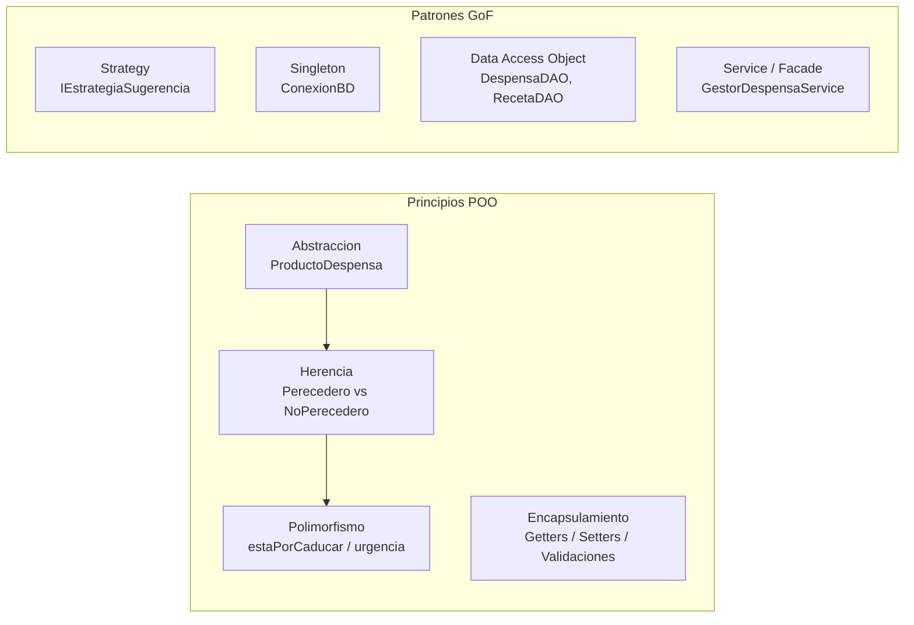
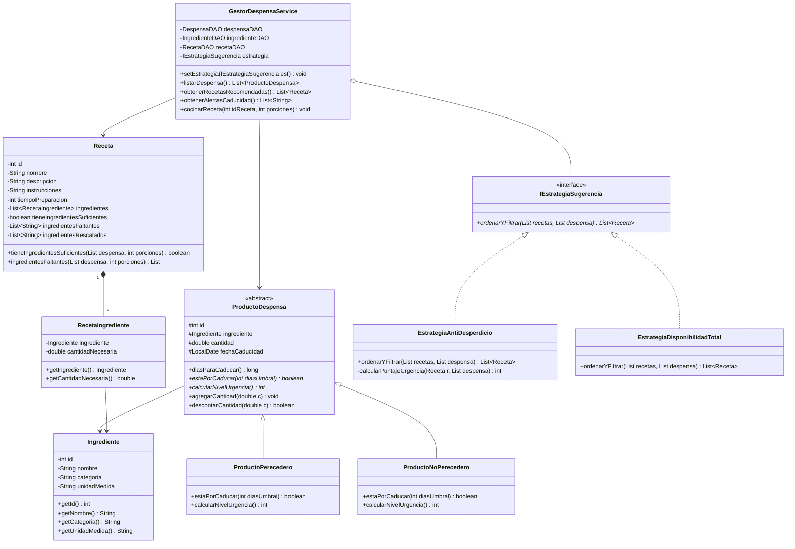
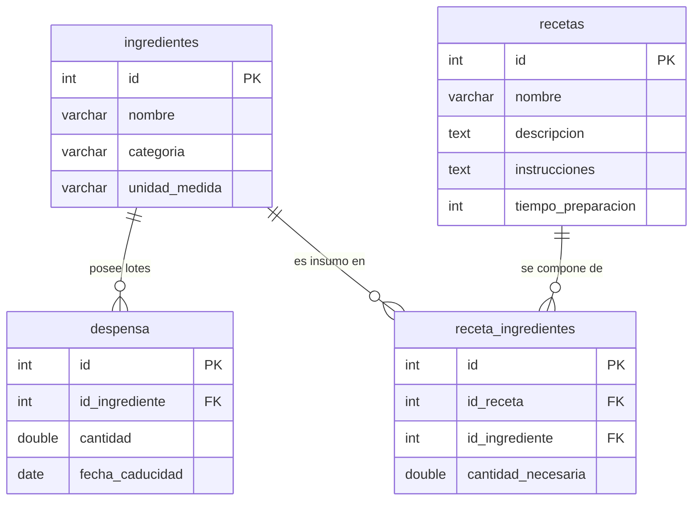

# FIT-EAT: Sistema Inteligente de Gestión de Despensa y Recetario Anti-Desperdicio
## Guion de Exposición y Estructura de Diapositivas para Defensa Académica (20 Minutos)

**Materia:** Programación Orientada a Objetos II (POO2)  
**Semestre:** 3er Semestre de Ingeniería  
**Ponente:** Alan Baruch  
**Duración Total:** 20 minutos cronometrados  

---

## ⏱️ Distribución de Tiempos de la Exposición (Total: 20:00 min)

| Bloque | Tema | Minutos Asignados | Cronómetro Acumulado |
| :---: | :--- | :---: | :---: |
| **1** | Portada, Introducción, Problemática y Objetivos | 2:00 min | 0:00 - 2:00 |
| **2** | Análisis y Diseño Orientado a Objetos (POO y Patrones) | 3:00 min | 2:00 - 5:00 |
| **3** | Diagrama UML de Clases y Relaciones | 2:30 min | 5:00 - 7:30 |
| **4** | Tecnologías Utilizadas y Organización en IntelliJ IDEA | 2:00 min | 7:30 - 9:30 |
| **5** | Arquitectura del Sistema y Modelo J2EE (Multicapa) | 2:00 min | 9:30 - 11:30 |
| **6** | Base de Datos MySQL y Conectividad JDBC (Patrón Singleton) | 1:30 min | 11:30 - 13:00 |
| **7** | Servicios Web REST e Intercambio de Información con JSON | 1:30 min | 13:00 - 14:30 |
| **8** | **Demostración en Tiempo Real del Sistema (En Vivo)** | 4:00 min | 14:30 - 18:30 |
| **9** | Conclusiones, Trabajo Futuro y Sesión de Preguntas | 1:30 min | 18:30 - 20:00 |

---

## Diapositiva 1: Portada
**Título:** FIT-EAT: Tu cocina, más inteligente y sin desperdicio  
**Subtítulo:** Sistema Web de Gestión de Inventario por Lotes y Sugerencia Algorítmica de Recetas  
**Datos:** Proyecto Final de POO2 · Ingeniería en Computación / Sistemas · Ponente: Alan Baruch  

> [!NOTE]
> **Notas del Orador (0:00 - 0:45):**  
> *"Buenos días, profesor y miembros del sínodo. Mi nombre es Alan Baruch y el día de hoy les presento el proyecto final de la materia Programación Orientada a Objetos II, titulado **FIT-EAT: Sistema Inteligente de Gestión de Despensa y Recetario Anti-Desperdicio**.  
> Este proyecto combina los principios de la programación orientada a objetos avanzada, patrones de diseño GoF, arquitectura multicapa en el entorno Jakarta EE / J2EE, persistencia relacional con MySQL y servicios web REST, integrados en una experiencia de usuario moderna y funcional orientada a solucionar un problema crítico de nuestra vida cotidiana."*

---

## Diapositiva 2: Introducción, Problemática y Objetivos
**Título:** Problemática y Justificación del Sistema  

### Problemática Identificada:
1. **Desperdicio Alimentario:** Según la FAO, un tercio de los alimentos producidos anualmente en el mundo termina en la basura, siendo los hogares el foco de mayor impacto.
2. **Falta de Trazabilidad:** Las personas compran insumos sin recordar qué tienen en casa ni qué fechas de caducidad están por expirar.
3. **Parálisis de Elección:** Al abrir el refrigerador, el usuario no sabe qué cocinar combinando exclusivamente lo que ya tiene y lo que corre riesgo inminente de descomponerse.

### Objetivos del Proyecto:
- **Objetivo General:** Desarrollar una aplicación web integral en Java que gestione el inventario doméstico bajo control de lotes y fechas de vencimiento, recomendando recetas inteligentes para minimizar el desperdicio.
- **Objetivos Específicos:**
  - Modelar el dominio mediante POO aplicando herencia, abstracción y polimorfismo.
  - Implementar el patrón de diseño **Strategy** para permitir alternar entre recomendaciones Anti-Desperdicio y Disponibilidad Total.
  - Diseñar un algoritmo de consumo **FIFO (First In, First Out)** que descuente automáticamente los lotes más antiguos al cocinar.
  - Exponer una API REST desacoplada que comunique el backend en Java con un frontend web responsivo mediante JSON.

> [!NOTE]
> **Notas del Orador (0:45 - 2:00):**  
> *"¿Por qué FIT-EAT? Cada año, millones de toneladas de alimentos comestibles se tiran a la basura en nuestros hogares simplemente porque olvidamos que estaban en el fondo del refrigerador. FIT-EAT nació con un doble propósito: primero, proporcionar una herramienta práctica con alertas preventivas y consumo inteligente FIFO; y segundo, servir como un modelo de ingeniería donde cada requerimiento de negocio se traduce directamente en principios rigurosos de programación orientada a objetos."*

---

## Diapositiva 3: Análisis y Diseño Orientado a Objetos (POO)
**Título:** Fundamentos de POO y Patrones de Diseño Aplicados  



### Conceptos Clave Implementados:
- **Abstracción:** Se define la clase abstracta `ProductoDespensa` que modela las propiedades comunes (`id`, `ingrediente`, `cantidad`, `fechaCaducidad`) y declara métodos abstractos obligatorios: `estaPorCaducar(int dias)` y `calcularNivelUrgencia()`.
- **Herencia y Polimorfismo:**
  - `ProductoPerecedero`: Sobrescribe `estaPorCaducar()` evaluando la diferencia de días entre la fecha actual (`LocalDate.now()`) y su vencimiento.
  - `ProductoNoPerecedero`: Define que nunca caduca (`return false`) y mantiene urgencia neutra (`return 0`).
- **Patrón Strategy (GoF):**
  - Interfaz `IEstrategiaSugerencia` que define el contrato `List<Receta> ordenarYFiltrar(List<Receta> recetas, List<ProductoDespensa> despensa)`.
  - Permite intercambiar en tiempo de ejecución entre `EstrategiaAntiDesperdicio` y `EstrategiaDisponibilidadTotal` sin modificar el servicio ni los clientes.
- **Patrón DAO (Data Access Object):** Desacopla la lógica de negocio de las consultas SQL mediante clases especializadas (`DespensaDAO`, `IngredienteDAO`, `RecetaDAO`).
- **Patrón Singleton:** Garantiza una única instancia de `ConexionBD` con sincronización multi-hilo (`synchronized`).

> [!NOTE]
> **Notas del Orador (2:00 - 5:00):**  
> *"En el diseño del sistema evitamos completamente las estructuras monolíticas o el código procedural. Aplicamos los 4 pilares de la POO. En lugar de llenar el sistema de condicionales para saber si un producto vence o no, creamos una jerarquía polimórfica: `ProductoDespensa` como clase base abstracta, de la cual derivan `ProductoPerecedero` y `ProductoNoPerecedero`.  
> Además, para la recomendación de recetas utilizamos el patrón **Strategy**: la clase `GestorDespensaService` desconoce los detalles matemáticos de ordenamiento; simplemente delega la tarea a una implementación de `IEstrategiaSugerencia`. Esto cumple cabalmente con el principio Open/Closed de SOLID: si mañana queremos añadir una estrategia Keto o Económica, solo creamos una nueva clase sin tocar una sola línea del código existente."*

---

## Diapositiva 4: Diagrama UML de Clases
**Título:** Diagrama UML Estructural del Sistema  



> [!NOTE]
> **Notas del Orador (5:00 - 7:30):**  
> *"En pantalla observamos el diagrama UML de clases. Aprecien la clara división de responsabilidades:  
> 1. En el núcleo del modelo, `ProductoDespensa` contiene una agregación con `Ingrediente`.  
> 2. `Receta` mantiene una composición fuerte con `RecetaIngrediente`, la cual vincula cada insumo con su cantidad requerida para una porción estándar.  
> 3. El polimorfismo se hace evidente en la relación de generalización hacia `ProductoPerecedero` y `ProductoNoPerecedero`.  
> 4. La interfaz `IEstrategiaSugerencia` se asocia mediante agregación débil con `GestorDespensaService`, lo que posibilita que el servicio alterne en caliente la estrategia sin reconstruir su estado."*

---

## Diapositiva 5: Tecnologías y Organización del Proyecto en IntelliJ IDEA
**Título:** Stack Tecnológico y Estructura del Proyecto  

| Capa / Rol | Tecnología Utilizada | Justificación Técnica |
| :--- | :--- | :--- |
| **Lenguaje** | Java 17/21 (Adoptium JDK) | Rendimiento, tipado estático robusto, API moderna de `java.time` (`LocalDate`, `ChronoUnit`). |
| **Construcción** | Apache Maven 3.9+ | Gestión estandarizada de ciclo de vida (`pom.xml`), dependencias y empaquetado en archivo WAR. |
| **Servidor Web** | Apache Tomcat 11.0 | Contenedor de servlets de alto rendimiento compatible con especificación Jakarta EE 10 / Servlet 6.0. |
| **Persistencia** | MySQL Server 8.0 + Connector/J | Base de datos relacional transaccional ACID con driver JDBC oficial. |
| **Serialización** | Google Gson 2.10.1 | Transformación bidireccional automática entre Java POJOs y cadenas JSON. |
| **Frontend** | Vanilla JS (ES6+), HTML5, CSS3 | Arquitectura SPA ligera, libre de dependencias pesadas, carga instantánea y animaciones fluidas. |

### Organización en IntelliJ IDEA:
```
proyectoFinal/
├── pom.xml                                   <- Descriptor Maven
├── src/
│   ├── main/
│   │   ├── java/
│   │   │   ├── controlador/                  <- Servlets HTTP (DespensaServlet, RecetaServlet)
│   │   │   ├── dao/                          <- Acceso a Datos y Conexión JDBC (ConexionBD)
│   │   │   ├── estrategia/                   <- Patrón Strategy (Interfaces e Implementaciones)
│   │   │   ├── modelo/                       <- Clases del Dominio POO (Entidades y Abstracciones)
│   │   │   ├── service/                      <- Lógica de Negocio y Fachada (GestorDespensaService)
│   │   │   └── util/                         <- Serializadores JSON y utilidades
│   │   ├── resources/                        <- Esquemas SQL, semillas JSON e imágenes
│   │   └── webapp/                           <- SPA Web (index.html, styles.css, app.js, WEB-INF)
│   └── test/java/                            <- Pruebas unitarias JUnit 5
```

> [!NOTE]
> **Notas del Orador (7:30 - 9:30):**  
> *"La organización del proyecto en IntelliJ IDEA sigue rigurosamente el estándar industrial de Maven. Separamos limpiamente el código fuente por responsabilidades en paquetes dedicados: `controlador` para los servlets Jakarta, `modelo` para las entidades del negocio, `dao` para la persistencia, `service` para los casos de uso y `estrategia` para los algoritmos. El frontend reside de forma desacoplada dentro del directorio `webapp`, listo para ser desplegado como un archivo WAR ejecutable en Apache Tomcat."*

---

## Diapositiva 6: Arquitectura General del Sistema y Modelo J2EE
**Título:** Arquitectura Multicapa en el Modelo J2EE / Jakarta EE  

```mermaid
graph TD
    subgraph Capa de Presentacion [Cliente / Browser]
        UI[SPA HTML5 / CSS3 / Vanilla JS]
        Fetch[API Fetch Asincrono - JSON]
    end

    subgraph Capa Web / Control [J2EE Container - Tomcat]
        DS[DespensaServlet]
        RS[RecetaServlet]
        IS[IngredienteServlet]
    end

    subgraph Capa de Negocio [Reglas del Dominio]
        GDS[GestorDespensaService]
        STG[EstrategiaAntiDesperdicio / DisponibilidadTotal]
        FIFO[Algoritmo de Descuento FIFO]
    end

    subgraph Capa de Integracion / Datos [Persistencia JDBC]
        DAO[DespensaDAO / RecetaDAO / IngredienteDAO]
        CBD[ConexionBD - Singleton]
    end

    subgraph Capa de Almacenamiento [RDBMS]
        DB[(MySQL 8.0 - despensa_db)]
    end

    UI --> Fetch
    Fetch -->|HTTP GET/POST/PUT/DELETE| Capa Web / Control
    DS & RS & IS -->|DTOs y Entidades| GDS
    GDS --> STG
    GDS --> FIFO
    GDS --> DAO
    DAO --> CBD
    CBD -->|Protocolo JDBC| DB
```

### Características de la Arquitectura J2EE:
1. **Desacoplamiento Estricto:** La capa web solo traduce peticiones HTTP en llamadas a servicios y formatea respuestas en JSON.
2. **Independencia de la Base de Datos:** Los controladores nunca ejecutan SQL directamente; la persistencia queda aislada en los DAOs.
3. **Escalabilidad y Transaccionalidad:** El diseño por capas permite migrar fácilmente la capa de persistencia a JPA/Hibernate o sustituir el frontend sin alterar la lógica central del negocio.

> [!NOTE]
> **Notas del Orador (9:30 - 11:30):**  
> *"El sistema implementa una arquitectura multicapa alineada con los estándares de J2EE. El flujo es unidireccional: la vista en el navegador envía peticiones HTTP asíncronas hacia nuestros Servlets; los Servlets delegan inmediatamente a la capa de servicio `GestorDespensaService` donde se aplican las reglas de negocio; y finalmente los DAOs se encargan del intercambio con MySQL mediante JDBC. Esto asegura alta cohesión y bajo acoplamiento en todo el sistema."*

---

## Diapositiva 7: Base de Datos MySQL y Conectividad JDBC
**Título:** Modelo Relacional y Conectividad Robusta mediante JDBC  



### Aspectos Técnicos Destacados:
- **Gestión por Lotes:** La tabla `despensa` no agrupa ciegamente cantidades; mantiene cada lote independiente con su propia `fecha_caducidad`. Esto permite saber con precisión qué lote vence antes.
- **Patrón Singleton en `ConexionBD`:** Centraliza la apertura de conexiones evitando la sobrecarga de conexiones concurrentes y garantizando reconexión automática si la conexión se cierra.
- **Seguridad Contra SQL Injection:** Todas las sentencias utilizan `PreparedStatement` con parámetros tipados (`ps.setInt()`, `ps.setDouble()`), protegiendo la base de datos contra ataques de inyección.

> [!NOTE]
> **Notas del Orador (11:30 - 13:00):**  
> *"En el diseño relacional de MySQL en `despensa_db`, la decisión técnica clave fue registrar los productos en la tabla `despensa` por **lotes**. Si compras 1 litro de leche hoy que vence en 10 días, y tenías medio litro en el refrigerador que vence mañana, el sistema no los mezcla: los registra en dos filas distintas. Esto habilita que la conectividad JDBC y nuestro algoritmo FIFO descuenten primero el producto más antiguo al momento de cocinar."*

---

## Diapositiva 8: Servicios Web REST e Intercambio de Información con JSON
**Título:** Endpoints RESTful y Serialización JSON  

| Endpoint | Método HTTP | Función / Operación | Parámetros / Payload |
| :--- | :---: | :--- | :--- |
| `/api/ingredientes` | `GET` | Obtener el catálogo maestro de ingredientes disponibles. | Ninguno. |
| `/api/despensa` | `GET` | Listar todos los lotes en despensa con cálculo de días y estado. | `?alerta=true` (opcional). |
| `/api/despensa` | `POST` | Registrar un nuevo lote en la despensa. | `idIngrediente`, `cantidad`, `fechaCaducidad`. |
| `/api/despensa` | `PUT` | Actualizar la cantidad de un lote específico. | `{"id": 5, "cantidad": 750.0}` |
| `/api/despensa` | `DELETE` | Eliminar un lote consumido o desechado. | `?id=5` |
| `/api/recetas` | `GET` | Obtener recetas recomendadas según la estrategia activa. | `?estrategia=antidesperdicio` o `disponibilidad` |
| `/api/recetas` | `POST` | Cocinar una receta aplicando descuento FIFO por porciones. | `{"idReceta": 2, "porciones": 4}` |

### Estándar de Intercambio:
- Respuestas en formato `application/json;charset=UTF-8` serializadas con Google **Gson**.
- Respuestas estandarizadas con código HTTP (`200 OK`, `400 Bad Request`, `500 Internal Server Error`) y mensajes descriptivos.

> [!NOTE]
> **Notas del Orador (13:00 - 14:30):**  
> *"Nuestros Servlets operan como una API RESTful limpia. Implementamos los verbos estándar HTTP: GET para lecturas, POST para creaciones y acciones de cocinado, PUT para edición de inventario y DELETE para retirar lotes. Toda la información viaja en formato JSON codificado en UTF-8, lo que independiza por completo al frontend y permite que cualquier cliente móvil o web consuma el backend con total transparencia."*

---

## Diapositiva 9: Algoritmos Clave del Sistema
**Título:** Algoritmos: Estrategias de Sugerencia y Descuento FIFO  

### 1. Estrategia Anti-Desperdicio (Puntuación de Urgencia)
$$Puntaje = \sum_{insumos} (PuntajePorLote)$$
- Si caduca en $\le 2$ días: $+250$ puntos de prioridad.
- Si ya está vencido: $+180$ puntos de atención inmediata.
- Si caduca en 3 días: $+120$ puntos preventivos.
- Las recetas con mayor puntaje acumulado y que rescatan insumos críticos suben automáticamente a los primeros lugares.

### 2. Estrategia Disponibilidad Total (Rapidez y Cobertura)
- Clasifica primero las recetas con **100% de ingredientes suficientes** en despensa.
- Entre las que se pueden cocinar de inmediato, las ordena de **menor a mayor tiempo de preparación** ($5\text{ min} \to 10\text{ min} \to 12\text{ min} \dots$).

### 3. Algoritmo de Descuento FIFO (First In, First Out)
```
Por cada ingrediente requerido en la receta (cantidad_total = cantidad_unitaria * porciones):
   Consultar lotes en despensa WHERE id_ingrediente = X ORDER BY fecha_caducidad ASC
   Mientras cantidad_total > 0:
      Si lote.cantidad <= cantidad_total:
         cantidad_total -= lote.cantidad
         DELETE lote
      Si lote.cantidad > cantidad_total:
         lote.cantidad -= cantidad_total
         UPDATE lote
         cantidad_total = 0
```

> [!NOTE]
> **Notas del Orador (14:30 - 15:30):**  
> *"La inteligencia de FIT-EAT reside en estos dos algoritmos. La estrategia Anti-Desperdicio premia a las recetas que utilizan alimentos al borde de caducar. Por su parte, la estrategia de Disponibilidad Total busca conveniencia y rapidez. Y al dar clic en 'Cocinar', el algoritmo FIFO consulta la base de datos y consume en primer lugar los lotes con fecha de vencimiento más antigua, asegurando una rotación óptima del inventario doméstico."*

---

## Diapositiva 10: Demostración en Vivo - Dashboard y Despensa
**Título:** Demostración en Tiempo Real: Dashboard Principal  

```
+-----------------------------------------------------------------------------------------+
|                                                                                         |
|                  [ ESPACIO PARA SCREENSHOT: DASHBOARD PRINCIPAL ]                       |
|                                                                                         |
|   Insertar aquí captura de pantalla completa de la pantalla principal mostrando:       |
|   1. KPIs superiores (Lotes en despensa, Alertas rojas por caducar/vencidos, Recetas). |
|   2. Formulario interactivo con selector visual de ingredientes.                        |
|   3. Tabla de inventario actual con badges de estado y botones SVG de editar/eliminar.  |
|                                                                                         |
+-----------------------------------------------------------------------------------------+
```

### Puntos a Demostrar en Vivo:
1. Navegación fluida desde el Splash Screen inicial hasta el Dashboard.
2. Alta de un nuevo lote utilizando el selector modal con imágenes y asignación de fecha de caducidad.
3. Modificación en caliente de cantidad mediante modal AJAX y eliminación reactiva de un lote.

> [!NOTE]
> **Notas del Orador (15:30 - 16:30):**  
> *"Procedemos a la demostración en tiempo real. En la pantalla del Dashboard observamos los indicadores clave o KPIs actualizados en vivo: total de lotes, alimentos en riesgo y recetas listas.  
> Voy a registrar un nuevo ingrediente: abrimos el selector modal, seleccionamos por ejemplo Pechuga de Pollo, colocamos 500 gramos y fijamos su caducidad. Al guardar, el servlet procesa la petición y la tabla se actualiza al instante sin parpadeos de recarga completa."*

---

## Diapositiva 11: Demostración en Vivo - Control de Caducidades
**Título:** Demostración en Tiempo Real: Módulo Detallado de Caducidades  

```
+-----------------------------------------------------------------------------------------+
|                                                                                         |
|              [ ESPACIO PARA SCREENSHOT: CONTROL DETALLADO DE CADUCIDADES ]              |
|                                                                                         |
|   Insertar aquí captura de pantalla de la vista de caducidades mostrando:              |
|   1. Bloque rojo de productos Vencidos con días transcurridos y botón de desecho.      |
|   2. Bloque ámbar de productos Por Caducar (<=3 días) con contador regresivo.          |
|   3. Navegación rápida para volver al Dashboard.                                       |
|                                                                                         |
+-----------------------------------------------------------------------------------------+
```

### Puntos a Demostrar en Vivo:
1. Al hacer clic en la tarjeta KPI con punto de notificación rojo, se ingresa al panel especializado de caducidades.
2. Demostración de las alertas generadas por polimorfismo (`diasParaCaducar()` negativo para vencidos y positivo para próximos).
3. Acciones de corrección directa (eliminar lote caducado o ajustar inventario).

> [!NOTE]
> **Notas del Orador (16:30 - 17:30):**  
> *"Al hacer clic en el KPI de alimentos en riesgo, el sistema nos lleva a la vista especializada de caducidades. Aquí el polimorfismo de `ProductoPerecedero` categoriza en dos bloques independientes: en rojo los insumos ya vencidos recomendando su descarte seguro, y en ámbar los insumos próximos a caducar en los siguientes 3 días para su rescate prioritario."*

---

## Diapositiva 12: Demostración en Vivo - Recetario Inteligente y Cocinar FIFO
**Título:** Demostración en Tiempo Real: Conmutación de Estrategias y Cocinado FIFO  

```
+-----------------------------------------------------------------------------------------+
|                                                                                         |
|           [ ESPACIO PARA SCREENSHOT: RECETAS Y MODAL ¿VAMOS A COCINAR? ]                |
|                                                                                         |
|   Insertar aquí captura de pantalla mostrando:                                          |
|   1. Conmutador de estrategias (Anti-Desperdicio vs Disponibilidad Total).             |
|   2. Banner informativo y píldoras 'Salva: Leche/Tomate' vs '#1 Más rápida (5 min)'.   |
|   3. Modal ¿Vamos a Cocinar? con selector de porciones y toast de confirmación FIFO.   |
|                                                                                         |
+-----------------------------------------------------------------------------------------+
```

### Puntos a Demostrar en Vivo:
1. Conmutar entre **Anti-Desperdicio** (se resalta cómo suben las recetas que usan insumos por caducar) y **Disponibilidad Total** (se ordenan por rapidez de preparación: 5 min, 10 min, 12 min).
2. Abrir el modal *¿Vamos a Cocinar?*, ajustar el número de porciones y observar el cálculo en tiempo real de insumos requeridos vs disponibles.
3. Confirmar el cocinado: observar el toast verde de éxito y comprobar en la tabla cómo se descontaron automáticamente los lotes más antiguos bajo la lógica FIFO.

> [!NOTE]
> **Notas del Orador (17:30 - 18:30):**  
> *"Ahora observemos el cambio de estrategias en tiempo real. Si selecciono 'Anti-Desperdicio', el sistema sitúa en los primeros lugares platillos que rescatan leche y tomates próximos a vencer. Si conmutamos a 'Disponibilidad Total', el ranking cambia de inmediato priorizando las recetas más veloces: el Batido en 5 minutos, la Tortilla en 10 minutos y el Omelette en 12 minutos.  
> Finalmente, cocinamos una receta: seleccionamos 2 porciones y damos clic en 'Guardar'. El backend verifica suficiencia, aplica el algoritmo FIFO descontando los lotes más viejos y nos confirma con una notificación toast."*

---

## Diapositiva 13: Conclusiones y Posibles Mejoras
**Título:** Conclusiones del Proyecto y Trabajo Futuro  

### Logros y Conclusiones:
- **Cumplimiento Integral de Objetivos:** Se desarrolló una solución completa aplicando arquitectura orientada a objetos en Java, patrones de diseño GoF (Strategy, DAO, Singleton), base de datos relacional y servicios REST.
- **Impacto Social y Ecológico:** Demostración práctica de cómo el software puede resolver problemáticas reales de consumo responsable y reducción del desperdicio de comida.
- **Rendimiento y Experiencia:** Desacoplamiento total entre frontend y backend que garantiza tiempos de respuesta inferiores a 100 milisegundos en todas las operaciones.

### Posibles Mejoras y Trabajo Futuro:
1. **Reconocimiento Óptico (OCR) e Inteligencia Artificial:** Integración de escaneo de tickets de supermercado mediante visión por computadora para dar de alta inventario automáticamente.
2. **Escaneo de Códigos de Barras:** Consulta automática de bases de datos abiertas como *Open Food Facts* para obtener ingredientes y valores nutricionales al escanear el empaque.
3. **Módulo Nutricional:** Cálculo automático de macronutrientes (proteínas, carbohidratos, grasas) por porción cocinada.
4. **Aplicación Móvil Nativa:** Implementación en Android o Flutter consumiendo la misma API REST desarrollada en este proyecto.

> [!NOTE]
> **Notas del Orador (18:30 - 19:30):**  
> *"En conclusión, FIT-EAT demuestra cómo los principios de ingeniería de software y programación orientada a objetos no son conceptos teóricos aislados, sino herramientas indispensables para crear sistemas escalables, limpios y con impacto positivo en la sociedad.  
> Como líneas de trabajo futuro, el sistema está perfectamente preparado arquitectónicamente para incorporar lectura de tickets por OCR, escaneo de códigos de barras y aplicaciones móviles nativas sobre la misma API REST."*

---

## Diapositiva 14: Cierre y Preguntas
**Título:** ¡Muchas Gracias por su Atención!  
**Subtítulo:** Espacio para Preguntas, Dudas y Retroalimentación del Sínodo  

- **Repositorio y Código Fuente:** Proyecto Final POO2 · FIT-EAT
- **Tecnologías:** Java 17/21 · Jakarta EE · Tomcat 11 · MySQL 8.0 · REST JSON
- **Autor:** Alan Baruch  

> [!NOTE]
> **Notas del Orador (19:30 - 20:00):**  
> *"Con esto concluyo la exposición de FIT-EAT dentro del tiempo límite de 20 minutos. Agradezco enormemente su atención y quedo a su entera disposición para responder a cualquier pregunta o profundizar en los aspectos técnicos que consideren oportunos. Muchas gracias."*
